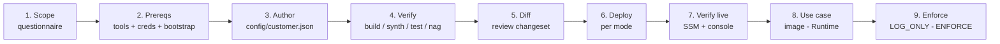
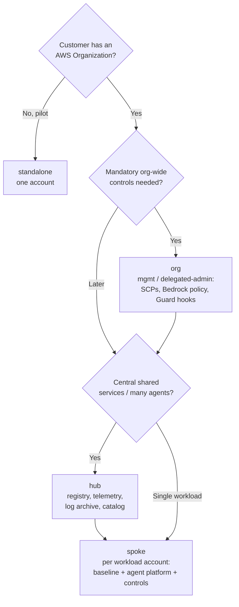
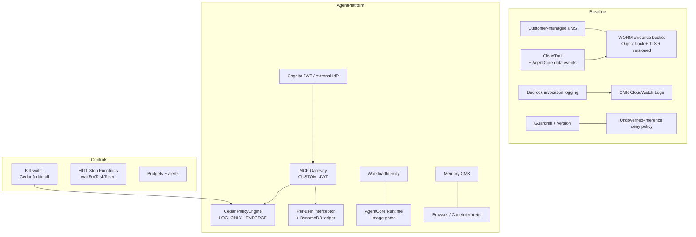
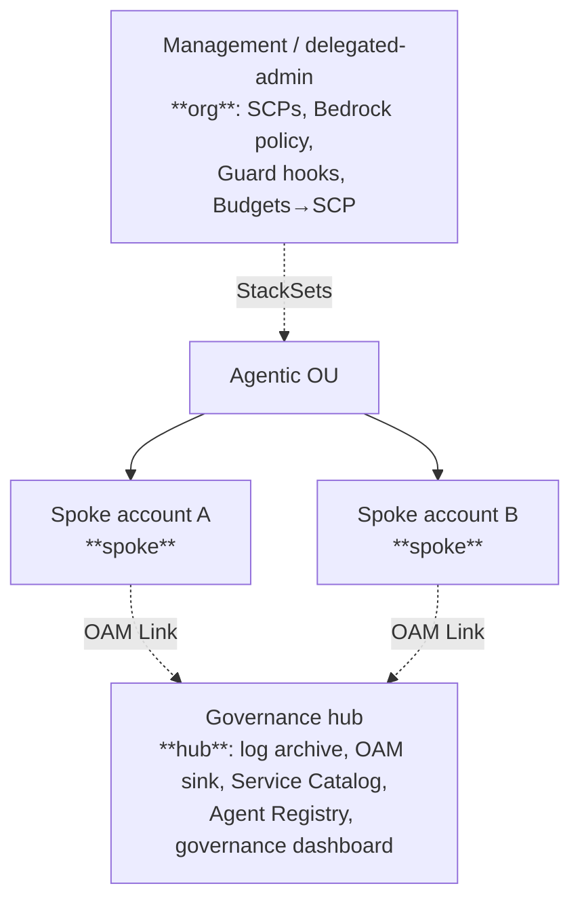

# Governed AI Platform — Deployment Runbook

**Audience:** AWS Solutions Architects deploying with a customer, and customer platform teams.
**What it deploys:** a config-driven governance platform for Amazon Bedrock AgentCore — guardrails,
audit, Cedar authorization, kill switches (incl. cost), budgets, per-user governance, Guard hooks,
detective Config rules, a governance dashboard, and an agent registry — across four modes.

This runbook is the single source of truth for a deployment. The per-mode files in this folder
(`standalone.md`, `hub.md`, `spoke.md`, `org.md`) are quick references; this document is the full plan.

---

## 1. High-level flow



Typical engagement: **standalone** pilot (one account, one use case) → graduate to **hub** + **spoke**
as the customer scales → add **org** controls once governance must be mandatory org-wide.

---

## 2. Which mode(s)? (decision tree)



| Mode | Target account | Stacks | Live-tested |
|---|---|---|---|
| `standalone` | one account (pilot) | Baseline + AgentPlatform + Controls (+ collapsed Hub) | ✅ deployed + validated |
| `spoke` | each workload account | Baseline + AgentPlatform + Controls | synth/nag (same stacks as standalone) |
| `hub` | dedicated governance account | GovernanceHub (log archive, OAM sink, Service Catalog, Agent Registry, governance dashboard) | synth/nag |
| `org` | management / delegated-admin | OrgFoundation (SCPs, Bedrock policy, Guard hooks, Budgets→SCP) | synth/nag — needs an Organization |

---

## 3. Architecture

### Standalone / spoke (the governed workload account)



### Governed request flow (validated live)

```mermaid
sequenceDiagram
  participant U as Human (CSR)
  participant A as Agent (Runtime)
  participant G as Gateway (MCP)
  participant I as Interceptor
  participant P as Cedar PolicyEngine
  participant T as Tool (Lambda target)
  U->>A: invoke (JWT access token)
  A->>G: MCP tools/call (Bearer JWT)
  G->>I: REQUEST interceptor (per-user block/allowlist/rate-limit)
  I-->>G: allow | deny (403)
  G->>P: authorize (principal, action, resource)
  P-->>G: permit | forbid (default-deny)
  G->>T: invoke tool (if permitted)
  Note over A,T: Consequential actions are forbidden to the agent;<br/>the HITL sign-off gate owns them.
```

### Hub + spoke + org topology



---

## 4. Pre-deployment: information to gather from the customer

Collect these **before** writing the config. (★ = blocks deployment if unknown.)

| # | Question | Config field | Notes |
|---|---|---|---|
| 1 ★ | Which AWS account(s) and region? | `region`, profiles | Confirm AgentCore availability in the region (us-east-1 / us-west-2 first). |
| 2 ★ | Partition — commercial or GovCloud? | `partition` | `aws` (default) or `aws-us-gov` (gated on per-service availability). |
| 3 ★ | Existing landing zone / Control Tower? | mode choice | Reuse it — add an **AI Workloads OU** (`org`) + **spoke**; don't rebuild greenfield. |
| 4 ★ | Data classification? | `dataClassification` | `public`/`internal`/`confidential`/`phi`/`cjis` — drives retention (≥365d for phi/cjis) + guardrail strength. |
| 5 ★ | Inbound identity provider? | `identity` | Cognito (brokered, default) or external Entra/Okta/Ping (`mode: direct` + `issuerUrl`). |
| 6 | Approved foundation models? | `agentcore.allowedModelIds`, `perUserGovernance.allowedModelsByGroup` | Per-Cognito-group model entitlements. |
| 7 ★ | Monthly budget + alert recipients? | `controls.monthlyBudgetUsd`, `budgetAlertEmails` | Also the cost kill-switch threshold (org mode). |
| 8 | Guardrail policy — denied topics, PII? | `governance.guardrail` | Start from the customer's AI-use policy / NIST AI RMF. |
| 9 | Human-in-the-loop required? | `controls.humanInTheLoop` | Consequential actions route to the sign-off gate. |
| 10 | Per-user governance (rate/budget/allowlist)? | `controls.perUserGovernance` | Gateway REQUEST interceptor + ledger. |
| 11 (org) ★ | Organization ID + Agentic OU ID? | `org.organizationId`, `org.agenticOuId` | SCP/Guard-hook/Budgets-action attachment targets. |
| 12 (org) | SCP-exempt deployer role name? | `org.deployerRoleName` | The break-glass role every SCP exempts. Default `govai-<customer>-platform-deployer`. |
| 13 (org) | Org guardrail floor ARN? | `org.orgGuardrailArn` | Pins the `BEDROCK_POLICY` declarative floor. |
| 14 | Use case(s) + consequential actions? | `agentcore.useCaseManifest` → `use-cases/<name>/manifest.yaml` | Tool targets + Cedar (permit by group, forbid consequential) auto-wired from the manifest. |
| 15 | Detective compliance rules wanted? | `controls.detectiveConfigRules` | SRA-style AWS Config rules (guardrails present, invocation logging on). Needs a Config recorder. |

---

## 5. Prerequisites

- **Node 22+**, repo deps: `npm ci`. CDK via `npx` (pinned in `package.json`).
- **AWS credentials for the target account/region.** Name the profile explicitly on every command
  (`--profile <name>`). **Never deploy from a personal/default profile.**
- **CDK bootstrap** (once per account/region): `npx cdk bootstrap aws://<account>/<region> --profile <name>`.
- For a use-case Runtime image: **Docker with buildx** (ARM64 cross-build) + ECR access.

---

## 6. Deploy (per mode)

```bash
# 0. (first time) confirm you are on the intended account
aws sts get-caller-identity --profile <name>

# 1. verify everything synthesizes, tests, and passes cdk-nag
npm ci && npm run build && npm test
npx cdk synth --quiet -c mode=<mode> -c configFile=config/<customer>.json -c nag=true

# 2. bootstrap (once per account/region)
npx cdk bootstrap aws://<account>/<region> --profile <name>

# 3. review the diff BEFORE deploying
npx cdk diff --all -c mode=<mode> -c configFile=config/<customer>.json --profile <name>

# 4. deploy
npx cdk deploy --all -c mode=<mode> -c configFile=config/<customer>.json --profile <name>
```

- **standalone / spoke:** deploy `Baseline` then `AgentPlatform` then `Controls` (CDK orders by dependency).
- **hub:** deploy in the dedicated governance account.
- **org:** deploy in the management / delegated-admin account; set `org.agenticOuId` so SCPs, the Guard
  hook, and the Budgets→SCP action attach to the Agentic OU.

The gateway's Cedar engine starts in **`LOG_ONLY`** — it observes and logs decisions without blocking.
Flip `agentcore.cedarMode` to **`ENFORCE`** after validating per-tool policies against real traffic.

---

## 7. Verify (live)

```bash
# discovery metadata published by every stack
aws ssm get-parameters-by-path --path /governed-ai/<customer>/<env> --recursive --profile <name>
```

- **Baseline:** guardrail `READY` + a pinned version; CloudTrail advanced selectors include
  `AWS::BedrockAgentCore::Gateway` / `Runtime`; Bedrock invocation logging configured; evidence bucket
  has Object Lock.
- **AgentPlatform:** gateway `READY` (CUSTOM_JWT / MCP); PolicyEngine bound; Cognito pool live; (if
  enabled) interceptor attached at REQUEST with `passRequestHeaders`.
- **Controls:** kill-switch SSM flag `normal`; HITL state machine; budget + alerts; (if
  `detectiveConfigRules`) two AWS Config rules `govai-detect-*` reporting COMPLIANT.
- **hub:** central WORM log archive; OAM sink; Service Catalog portfolio + product; Agent Registry;
  the **CloudWatch governance dashboard** `governed-ai-<customer>-<env>` (guardrail interventions,
  model invocations, gateway activity).
- **org:** SCPs attached to the OU; `BEDROCK_POLICY` present; Guard hook `ENABLED`; Budgets action
  `APPLY_SCP_POLICY`.

> **Governance dashboard vs. Omni:** D4 ships as a native `AWS::CloudWatch::Dashboard`. The richer
> CloudWatch **Omni Space** (`AWS::CloudWatch::Space` / `AWS::CloudWatch::OmniDashboard`) is a newer
> CFN type not in the pinned `aws-cdk-lib`; stand it up per-customer on top of the Transaction Search
> data (D2) when a full SQL-over-traces / evaluation workspace is wanted.

---

## 8. Deploy a use case (activate the Runtime)

The platform deploys without any agent. A use case adds the Runtime:

```bash
# 1. compile the manifest -> gateway targets + Cedar + guardrail + workflow prompt
python use-cases/_harness/render.py use-cases/<name>/manifest.yaml build/<name>

# 2. build + push the ARM64 agent image (Runtime is ARM64)
AWS_PROFILE=<name> REPO=govai-<name> bash use-cases/_harness/build-image.sh

# 3. set agentcore.runtimeImageUri to the pushed image, then deploy — Runtime activates
npx cdk deploy GovAI-<customer>-<env>-AgentPlatform -c mode=standalone -c configFile=config/<customer>.json --profile <name>
```

The agent authenticates the human and forwards their **access token** as the bearer on every MCP call,
so Cedar evaluates the real human principal. With no tool targets attached yet, the agent correctly
reports **deny-by-default** — verified live.

---

## 9. Cost

Idle standing cost is small: ~**$1/month per KMS key** dominates; CloudTrail management events are free;
Cognito/DynamoDB/gateway idle ≈ $0. Variable cost is Bedrock inference (per token) + guardrail
evaluations + CloudWatch Logs + (org) a few cents of CloudFormation Guard/Hook activity. A full
deploy→validate→teardown pilot cycle costs pennies.

---

## 10. Teardown

```bash
# WORM evidence bucket must be emptied first (Object Lock blocks a plain destroy).
# GOVERNANCE mode (non-prod) allows a privileged bypass:
#   list + delete all versions with --bypass-governance-retention, then:
npx cdk destroy --all -c mode=<mode> -c configFile=config/<customer>.json --profile <name>
```

- **Gotcha:** CloudTrail keeps writing to the evidence bucket during teardown, so it can be non-empty
  again by the time the bucket deletes — empty it, then `delete-stack` the Baseline once more.
- Teardown removes the **account-level Bedrock invocation-logging** config (custom resource `onDelete`).
- Prod buckets/keys are `RETAIN` — delete manually with sign-off.

---

## 11. Troubleshooting — real deploy gotchas

These were all surfaced on live AWS deploys (synth + cdk-nag cannot catch them); the platform code
already handles them, but SAs will hit the same classes with customer variations:

| Symptom | Cause | Resolution |
|---|---|---|
| `PolicyEngine/Policy ... does not match pattern ^[A-Za-z][A-Za-z0-9_]*$` | AgentCore engine/policy names reject hyphens | Use underscores for engine/policy names (gateway names allow hyphens). |
| `Transaction Search is already enabled` (CFN resource) | account/region singleton | **Handled**: the platform enables it via an idempotent custom resource (no AlreadyExists; not disabled on teardown). |
| Gateway create: `AccessDenied ... GetPolicyEngine` / `AuthorizeAction` / `PartiallyAuthorizeActions` | Gateway role lacks Policy-in-AgentCore perms | Role needs `GetPolicyEngine` on the engine + `AuthorizeAction` + `PartiallyAuthorizeActions` on engine **and** gateway ARN. |
| Policy create: `Overly Permissive` | AgentCore automated reasoning rejects a blanket `permit` over "any future tools" | Don't attach a blanket baseline permit; attach tool-scoped policies once the gateway has a tool schema. |
| Agent invoke → gateway `500` on MCP `initialize` | Interceptor returned a malformed envelope | Interceptor output must be `{interceptorOutputVersion:"1.0", mcp:{transformedGatewayRequest | transformedGatewayResponse}}`. |
| ECR push: `broken pipe` to `:3128` | Docker Desktop's built-in proxy drops large layer uploads | Add `*.amazonaws.com` to Docker Desktop → Settings → Resources → Proxies → bypass (or set No proxy). |
| `cdk destroy` fails: bucket not empty | Object Lock + CloudTrail still writing | Empty with governance bypass, then retry the stack delete. |

---

## 12. Kill switch (incident response)

- **Fast (agent graph):** invoke the kill-switch Lambda with `{"action":"engage"}` — attaches a Cedar
  forbid-all to the policy engine (every tool call denied). `{"action":"release"}` restores.
- **Cost:** the Budgets→SCP action auto-attaches the freeze SCP at 100% of budget (org mode).
- **Broad (org):** the inference-perimeter SCP already denies Bedrock inference outside governed roles.
