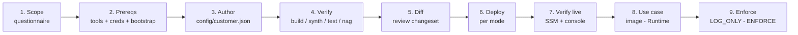
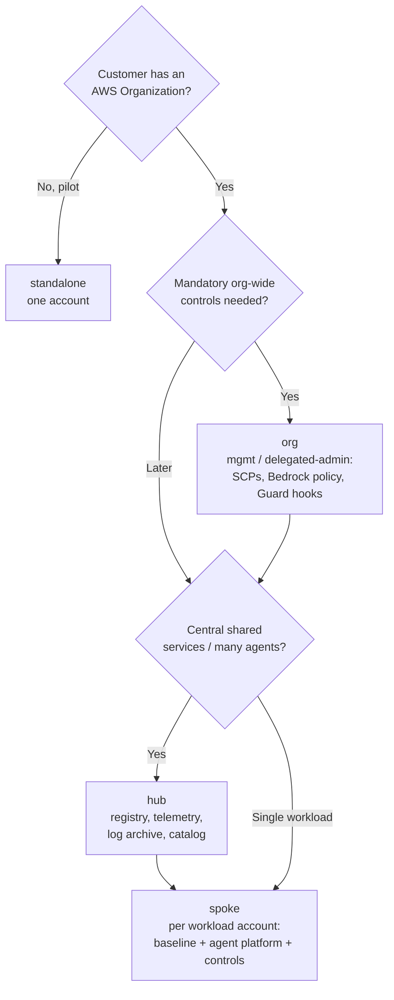
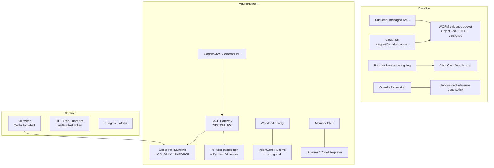
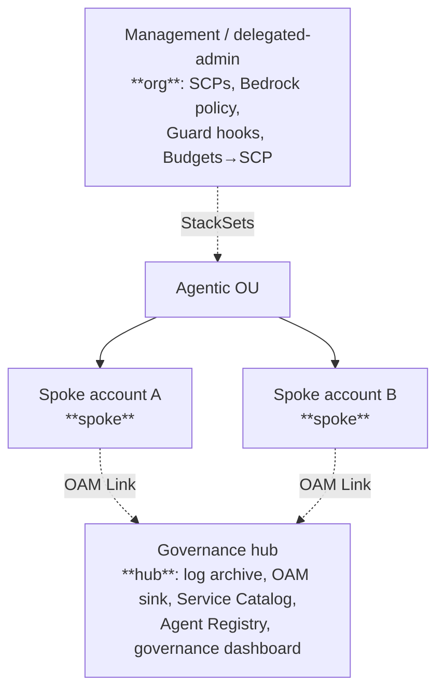

# Governed AI Platform — Deployment Runbook

**Audience:** AWS Solutions Architects deploying with a customer, and customer platform teams.
**What it deploys:** a config-driven governance platform for Amazon Bedrock AgentCore — guardrails,
audit, Cedar authorization, kill switches (incl. cost), budgets, per-user governance, Guard hooks,
detective Config rules, a governance dashboard, and an agent registry — across four modes.

This runbook is the single source of truth for a deployment. The per-mode files in this folder
(`standalone.md`, `hub.md`, `spoke.md`, `org.md`) are quick references; this document is the full plan.

> **Read first — maturity & supported scope.** This is a governance **accelerator** in a hardening
> phase (see `docs/REMEDIATION.md` and the README maturity matrix). **Supported for customer
> deployment today: `standalone` (single-account pilot)** — after you complete §A–§E below and the
> acceptance checklist (§15). `hub`/`spoke` cross-account integration is **partial** (OAM links +
> evidence delivery not complete), `org` enforcement is **synth-tested only** (validate in a test OU
> first), and **multi-agent A2A is IAM scaffolding, not working orchestration** — do not promise it.
> If you only do one thing from this runbook, do the §12 standalone walkthrough end to end.

## 0. Scope & responsibility (agree this with the customer before touching an account)

| Area | Platform provides | Customer owns |
|---|---|---|
| Deployment | CDK app, four mode profiles, runbook | Target account(s)/Org, CDK bootstrap, running `cdk deploy` against a named profile |
| Identity | Cognito pool + machine & human clients + groups (or trusts an external IdP) | Real users, group membership, IdP federation config, approver roster |
| Runtime | ARM64 agent harness + image build script | Building/scanning/publishing the image to ECR; the model + system prompt via the manifest |
| Governance | guardrail, Cedar enforce, kill switch, HITL, interceptor, logging | Approved guardrail content, forbidden tools, approver identities, incident ownership |
| Evidence | CloudTrail + invocation logs + WORM bucket + HITL ledger | Retention policy, evidence export, legal hold, access review |
| **Built but not yet live-validated** | hub/spoke cross-account integration (OAM links, evidence replication, catalog shares) — see §12c | validate across two real accounts in one Org before relying on it |
| **Explicit exclusions (today)** | — | org live enforcement, A2A orchestration, private-VPC networking, prod cost model |

---

## 1. High-level flow



Typical engagement: **standalone** pilot (one account, one use case) → graduate to **hub** + **spoke**
as the customer scales → add **org** controls once governance must be mandatory org-wide.

---

## 2. Which mode(s)? (decision tree)



| Mode | Target account | Stacks | Live-tested |
|---|---|---|---|
| `standalone` | one account (pilot) | Baseline + AgentPlatform + Controls (+ collapsed Hub) | ✅ deployed + validated |
| `spoke` | each workload account | Baseline + AgentPlatform + Controls | synth/nag (same stacks as standalone) |
| `hub` | dedicated governance account | GovernanceHub (log archive, OAM sink, Service Catalog, Agent Registry, governance dashboard) | synth/nag |
| `org` | management / delegated-admin | OrgFoundation (SCPs, Bedrock policy, Guard hooks, Budgets→SCP) | synth/nag — needs an Organization |

---

## 3. Architecture

### Standalone / spoke (the governed workload account)



### Governed request flow (validated live)

```mermaid
sequenceDiagram
  participant U as Human (CSR)
  participant A as Agent (Runtime)
  participant G as Gateway (MCP)
  participant I as Interceptor
  participant P as Cedar PolicyEngine
  participant T as Tool (Lambda target)
  U->>A: invoke (JWT access token)
  A->>G: MCP tools/call (Bearer JWT)
  G->>I: REQUEST interceptor (per-user block/allowlist/rate-limit)
  I-->>G: allow | deny (403)
  G->>P: authorize (principal, action, resource)
  P-->>G: permit | forbid (default-deny)
  G->>T: invoke tool (if permitted)
  Note over A,T: Consequential actions are forbidden to the agent;<br/>the HITL sign-off gate owns them.
```

### Hub + spoke + org topology



---

## 4. Pre-deployment: information to gather from the customer

Collect these **before** writing the config. (★ = blocks deployment if unknown.)

| # | Question | Config field | Notes |
|---|---|---|---|
| 1 ★ | Which AWS account(s) and region? | `region`, profiles | Confirm AgentCore availability in the region (us-east-1 / us-west-2 first). |
| 2 ★ | Partition — commercial or GovCloud? | `partition` | `aws` (default) or `aws-us-gov` (gated on per-service availability). |
| 3 ★ | Existing landing zone / Control Tower? | mode choice | Reuse it — add an **AI Workloads OU** (`org`) + **spoke**; don't rebuild greenfield. |
| 4 ★ | Data classification? | `dataClassification` | `public`/`internal`/`confidential`/`phi`/`cjis` — drives retention (≥365d for phi/cjis) + guardrail strength. |
| 5 ★ | Inbound identity provider? | `identity` | Cognito (brokered, default) or external Entra/Okta/Ping (`mode: direct` + `issuerUrl`). |
| 6 | Approved foundation models? | `agentcore.allowedModelIds`, `perUserGovernance.allowedModelsByGroup` | Per-Cognito-group model entitlements. |
| 7 ★ | Monthly budget + alert recipients? | `controls.monthlyBudgetUsd`, `budgetAlertEmails` | Also the cost kill-switch threshold (org mode). |
| 8 | Guardrail policy — denied topics, PII? | `governance.guardrail` | Start from the customer's AI-use policy / NIST AI RMF. |
| 9 | Human-in-the-loop required? | `controls.humanInTheLoop` | Consequential actions route to the sign-off gate. |
| 10 | Per-user governance (rate/budget/allowlist)? | `controls.perUserGovernance` | Gateway REQUEST interceptor + ledger. |
| 11 (org) ★ | Organization ID + Agentic OU ID? | `org.organizationId`, `org.agenticOuId` | SCP/Guard-hook/Budgets-action attachment targets. |
| 12 (org) | SCP-exempt deployer role name? | `org.deployerRoleName` | The break-glass role every SCP exempts. Default `govai-<customer>-platform-deployer`. |
| 13 (org) | Org guardrail floor ARN? | `org.orgGuardrailArn` | Pins the `BEDROCK_POLICY` declarative floor. |
| 14 | Use case(s) + consequential actions? | `agentcore.useCaseManifest` → `use-cases/<name>/manifest.yaml` | Tool targets + Cedar (permit by group, forbid consequential) auto-wired from the manifest. |
| 15 | Detective compliance rules wanted? | `controls.detectiveConfigRules` | SRA-style AWS Config rules (guardrails present, invocation logging on). Needs a Config recorder. |
| 16 ★ | **Existing Bedrock model-invocation logging** in this account/region? | `governance.invocationLoggingOwnership` | `create` (default) **refuses to overwrite** an existing config. Use `adopt` to keep theirs, `manage` to take over (restored on teardown). Check with `aws bedrock get-model-invocation-logging-configuration`. |
| 17 ★ | Active SCPs / permission boundaries on the target account? | — | They can block CDK execution roles. Confirm the deployer principal is exempt; test a `cdk diff` first. |
| 18 | Human approver roster + sign-in groups? | `identity.humanAuth.groups` | The group the use-case Cedar permits (e.g. `csr-agents`) must exist and have members — see §A. |
| 19 | Bedrock model-access enabled + service quotas? | — | Enable model access in the Bedrock console; confirm AgentCore + inference-profile quotas in-region. |

**Data boundary (confirm explicitly):** approved models + inference regions, data residency, whether
full prompt/response payload logging is permitted (invocation logs capture content — redaction in a
response does not sanitize the input log), evidence-key ownership, and whether private connectivity
(VPC/PrivateLink) is required (the Runtime/Browser use PUBLIC network mode today — a supported-profile
decision, not an assurance it fits every boundary).

---

## 5. Prerequisites

- **Node 22+**, repo deps: `npm ci`. CDK via `npx` (pinned in `package.json`).
- **AWS credentials for the target account/region.** Name the profile explicitly on every command
  (`--profile <name>`). **Never deploy from a personal/default profile.**
- **CDK bootstrap** (once per account/region): `npx cdk bootstrap aws://<account>/<region> --profile <name>`.
- For a use-case Runtime image: **Docker with buildx** (ARM64 cross-build) + ECR access.

---

## 6. Deploy (per mode)

```bash
# 0. (first time) confirm you are on the intended account
aws sts get-caller-identity --profile <name>

# 1. verify everything synthesizes, tests, and passes cdk-nag
npm ci && npm run build && npm test
npx cdk synth --quiet -c mode=<mode> -c configFile=config/<customer>.json -c nag=true

# 2. bootstrap (once per account/region)
npx cdk bootstrap aws://<account>/<region> --profile <name>

# 3. review the diff BEFORE deploying
npx cdk diff --all -c mode=<mode> -c configFile=config/<customer>.json --profile <name>

# 4. deploy
npx cdk deploy --all -c mode=<mode> -c configFile=config/<customer>.json --profile <name>
```

- **standalone / spoke:** deploy `Baseline` then `AgentPlatform` then `Controls` (CDK orders by dependency).
- **hub:** deploy in the dedicated governance account.
- **org:** deploy in the management / delegated-admin account; set `org.agenticOuId` so SCPs, the Guard
  hook, and the Budgets→SCP action attach to the Agentic OU.

The gateway's Cedar engine starts in **`LOG_ONLY`** — it observes and logs decisions without blocking.
Flip `agentcore.cedarMode` to **`ENFORCE`** after validating per-tool policies against real traffic.

---

## 7. Verify (live)

```bash
# discovery metadata published by every stack
aws ssm get-parameters-by-path --path /governed-ai/<customer>/<env> --recursive --profile <name>
```

- **Baseline:** guardrail `READY` + a pinned version; CloudTrail advanced selectors include
  `AWS::BedrockAgentCore::Gateway` / `Runtime`; Bedrock invocation logging configured; evidence bucket
  has Object Lock.
- **AgentPlatform:** gateway `READY` (CUSTOM_JWT / MCP); PolicyEngine bound; Cognito pool live; (if
  enabled) interceptor attached at REQUEST with `passRequestHeaders`.
- **Controls:** kill-switch SSM flag `normal`; HITL state machine; budget + alerts; (if
  `detectiveConfigRules`) two AWS Config rules `govai-detect-*` reporting COMPLIANT.
- **hub:** central WORM log archive; OAM sink; Service Catalog portfolio + product; Agent Registry;
  the **CloudWatch governance dashboard** `governed-ai-<customer>-<env>` (guardrail interventions,
  model invocations, gateway activity).
- **hub (Omni upgrade):** if `agentcore.omni.domainId` is set, a CloudWatch **Omni Space**
  `govai-<customer>-<env>` in `ACTIVE`/`CREATED` status plus its space operator / data-access role.
- **org:** SCPs attached to the OU; `BEDROCK_POLICY` present; Guard hook `ENABLED`; Guard-hook
  **StackSet** `govai-<customer>-guard-hook` (service-managed, auto-deploy to the Agentic OU);
  Budgets action `APPLY_SCP_POLICY`.

> **Governance dashboard vs. Omni:** D4 ships as a native `AWS::CloudWatch::Dashboard` — always on,
> no prerequisites. The richer CloudWatch **Omni Space** (`AWS::CloudWatch::Space`, declared via the
> raw `CfnResource` escape hatch since it is newer than the pinned `aws-cdk-lib`) is an opt-in
> per-customer upgrade: unified + agent observability with auto-discovered topology, golden metrics,
> and (with `enableModelInference`) eval-driven agent observability. **Prerequisite:** an Omni
> **domain** created out-of-band during Omni onboarding (CloudWatch console + SSO; there is no CFN
> domain resource) — set its `d-…` id as `agentcore.omni.domainId`. The construct creates the space
> operator / data-access role for you; a customer-managed key for Space encryption must carry the
> `cw-omni` tag and allow that role. Supply `agentcore.omni.dashboardBody` only if you want an
> explicit `AWS::CloudWatch::OmniDashboard` (otherwise Omni's auto-discovered dashboards apply).

---

## 8. Deploy a use case (activate the Runtime)

The platform deploys without any agent. A use case adds the Runtime:

```bash
# 1. compile the manifest -> gateway targets + Cedar + guardrail + workflow prompt
python use-cases/_harness/render.py use-cases/<name>/manifest.yaml build/<name>

# 2. build + push the ARM64 agent image (Runtime is ARM64)
AWS_PROFILE=<name> REPO=govai-<name> bash use-cases/_harness/build-image.sh

# 3. set agentcore.runtimeImageUri to the pushed image, then deploy — Runtime activates
npx cdk deploy GovAI-<customer>-<env>-AgentPlatform -c mode=standalone -c configFile=config/<customer>.json --profile <name>
```

The agent authenticates the human and forwards their **access token** as the bearer on every MCP call,
so Cedar evaluates the real human principal. With no tool targets attached yet, the agent correctly
reports **deny-by-default** — verified live.

---

## A. Identity — provision a human who can drive the governed workflow

The use-case Cedar policy permits a Cognito **group** (e.g. `csr-agents`); a human must sign in and
present a JWT carrying `cognito:groups`. The platform provisions the group + a human app client when
`identity.humanAuth.enabled` is set; **you create the users** (IaC must not bake in credentials):

```bash
POOL=$(aws ssm get-parameter --name /governed-ai/<customer>/<env>/agent-platform/user-pool-id \
  --query Parameter.Value --output text --profile <p> --region <r>)
HUMAN_CLIENT=$(aws ssm get-parameter --name /governed-ai/<customer>/<env>/agent-platform/human-client-id \
  --query Parameter.Value --output text --profile <p> --region <r>)

# Create an authorized CSR (in the csr-agents group) and an unauthorized viewer (in NO group).
./scripts/create-human-user.sh --pool-id "$POOL" --username csr-alice  --group csr-agents --profile <p> --region <r>
./scripts/create-human-user.sh --pool-id "$POOL" --username viewer-bob --group ""          --profile <p> --region <r>

# Obtain a token (requires identity.humanAuth.enableUserPasswordAuth). Use the ID token (carries groups).
aws cognito-idp initiate-auth --region <r> --profile <p> --auth-flow USER_PASSWORD_AUTH \
  --client-id "$HUMAN_CLIENT" --auth-parameters USERNAME=csr-alice,PASSWORD='<pw>' \
  --query 'AuthenticationResult.IdToken' --output text
```
Expired tokens, wrong-client tokens, and users with no group must be denied at the gateway (see §15).

## B. Governance semantics — decide and record these with the customer

- **Approved guardrail + version** (`baseline/guardrail-id`, `baseline/guardrail-version`): the runtime
  pins it; ungoverned inference is denied. For strict account-wide "only this guardrail" enforcement,
  design `aws bedrock put-enforced-guardrail-configuration` with the customer (account-wide blast radius).
- **Enforcement**: Cedar is `ENFORCE` by default. `LOG_ONLY` is observe-only and is rejected unless
  `agentcore.acknowledgeNonEnforcingCedar:true` — never ship a "governed" pilot in LOG_ONLY.
- **Forbidden/consequential actions**: the manifest `workflow.consequential_action` is Cedar-forbidden
  to the agent and routed through the HITL gate (§C).
- **Kill switch** (§12): engage attaches a forbid-all Cedar policy; release deletes it and verifies it
  is gone before reporting released. Scope = the gateway's tool calls (not in-flight model inference).

## C. Human-in-the-loop — how an approved action actually executes

1. The agent reaches the consequential step and calls `request_human_signoff` → starts the approval
   state machine (`govai-<customer>-<env>-hitl`) and returns a pending approval id. It does **not**
   perform the action (Cedar forbids it).
2. An approver resolves the waiting task (bind their identity):
   ```bash
   aws lambda invoke --function-name <Hitl ApprovalFn> --region <r> --profile <p> \
     --payload '{"taskToken":"<from SNS>","decision":"approve","approver":"supervisor-sam"}' out.json
   ```
3. The executor Lambda (a **separate** role — not the agent) performs the action **exactly once** and
   writes actor/approver/decision/result to the approvals ledger
   (`/governed-ai/<customer>/<env>/controls/hitl-approvals-table`). Re-approving the same digest does
   not re-execute. Reject/timeout record `REJECTED` and no action runs.

---

## 12b. Standalone reference walkthrough (clean checkout → verified transactions)

Do this end to end before telling a customer standalone is ready. Every step has an expected result.

```bash
# 1. Clean build + both test suites + nag (no AWS yet)
npm ci && npm run build && npm test && npm run test:lambda
npx cdk synth --quiet -c mode=standalone -c configFile=config/<customer>.json -c nag=true --profile <p>

# 2. Bootstrap + deploy (review the diff first)
npx cdk bootstrap aws://<account>/<r> --profile <p>
npx cdk deploy --all -c mode=standalone -c configFile=config/<customer>.json --profile <p> --require-approval broadening

# 3. Build + publish the ARM64 image by DIGEST, set runtimeImageUri, redeploy to activate the Runtime
./use-cases/_harness/build-image.sh --profile <p> --region <r> --repo govai-<customer> --tag v1
#   -> copy IMAGE_DIGEST_URI into config.agentcore.runtimeImageUri, then re-run the deploy above

# 4. Provision humans (§A), then run the positive + negative transactions
```
**Expected results (the acceptance core):**
- **Authorized human + allowed tool** → the tool executes; the ledger/trace shows `csr-alice` + case id.
- **Unauthorized identity** (`viewer-bob`, no group) → gateway returns deny-by-default; zero tools listed.
- **Consequential action** → the agent calls `request_human_signoff` and stops; nothing is filed until
  a human approves; approval files it **exactly once**; a second approval of the same digest is a no-op.
- **Kill switch engage** → subsequent tool calls are blocked at the gateway; **release** → access
  restored and the forbid policy is confirmed deleted (SSM flag back to `normal`).
- **Existing-logging safety** → with `invocationLoggingOwnership: adopt`/`create`, a pre-existing
  invocation-logging config in the account survives deploy **and** teardown.

---

## 12c. Hub/spoke connected deployment (two accounts) — built, not yet live-validated

Deliver spoke telemetry + evidence to a central hub. **Status:** the integration is implemented and
synth/nag/test-verified but has NOT been validated across two real accounts; treat this as a guided
first live validation, not a proven path. Requires a **hub account** and ≥1 **spoke account** in the
**same AWS Organization**.

**Order:** deploy the hub first, read its outputs, configure the spoke to point at them, deploy the spoke.

1. **Hub** (`-c mode=hub`): set `hub.organizationId` and `hub.monitoredAccountIds` (the spoke account
   ids). Deploy, then read the producer outputs:
   ```bash
   aws ssm get-parameters --region <r> --profile <hub> --names \
     /governed-ai/<customer>/<env>/hub/oam-sink-arn \
     /governed-ai/<customer>/<env>/hub/log-archive-bucket-arn \
     /governed-ai/<customer>/<env>/hub/log-archive-kms-arn \
     --query 'Parameters[].[Name,Value]' --output text
   ```
2. **Spoke** (`-c mode=spoke`): set in the spoke config —
   - `hub.accountId` = the hub account id,
   - `hub.oamSinkArn` = the hub OAM sink ARN (spoke creates an `AWS::Oam::Link`),
   - `hub.logArchiveBucketArn` + `hub.logArchiveKmsKeyArn` = the hub archive (spoke replicates evidence).
   Deploy the spoke. It creates the OAM link and an evidence-replication role
   `govai-<customer>-<env>-evidence-replication` (the hub archive already allow-lists this role name
   for the monitored accounts).
3. **Consumer-side steps the hub cannot do for the spoke:** associate an IAM principal in the spoke to
   the shared Service Catalog portfolio (`aws servicecatalog associate-principal-with-portfolio`); and
   accept the RAM share for the Agent Registry if your Org doesn't auto-accept.

**Verify (both accounts):**
- Spoke: `aws oam list-attached-links` shows the link `ACTIVE`; the evidence bucket has a replication
  configuration pointing at the hub archive.
- Hub: after spoke activity, the governance dashboard's per-spoke widget shows metrics; replicated
  evidence objects appear in the hub archive under the spoke's account.
- **Negative:** an account NOT in `monitoredAccountIds` / not in the Org cannot link to the sink or
  replicate (the sink policy is `aws:PrincipalOrgID`-scoped; the archive policy allow-lists specific
  accounts + the replication-role name).

**Known follow-ups:** cross-account KMS + Object-Lock replication is intricate — confirm replicas land
and are readable by the hub; the Agent Registry create does not yet poll `GetRegistry` for readiness.

## 12d. Org enforcement (SCPs/StackSets) — built, NOT yet live-validated; test-OU-first

**Do NOT attach the SCPs to an OU that contains an account you deploy/operate from without the exempt
roles in place — you can lock yourself out.** Validate in a **dedicated test OU** with throwaway
accounts before touching production.

**Prerequisites:** an AWS Organization (all-features), a test OU, management-account (or a configured
delegated-admin) access, trusted access enabled for the services used (StackSets, Bedrock org policy).

**Principal alignment (F03 — built):** the platform names its execution roles under the governed
prefix so the SCPs admit them — the runtime `govai-<customer>-governed-runtime-*` (inference allowed),
the kill switch `...-governed-killswitch-*` and invocation-logging `...-governed-invlog-*` (control-plane
exempted), plus the CDK CloudFormation execution role (`cdk-*-cfn-exec-role-*`) and the SCP-exempt
deployer. If you change `org.governedRolePrefix`, keep it consistent across all accounts.

**Deploy order:** (1) create the test OU + move throwaway spoke accounts in; (2) deploy the spoke
platform into those accounts FIRST (so the governed roles exist); (3) deploy `-c mode=org` from the
management account with `org.agenticOuId` = the test OU; (4) only then confirm the SCPs are attached.

**Guardrail floor (F13):** `org.orgGuardrailArn` must be a management-account-owned, numeric-version
guardrail with a resource policy sharing it to org members (the loader warns if it is not in
`org.managementAccountId`). Neither hub nor org creates that floor guardrail — provision it in the
management account first.

**Delegated admin (F13):** set `org.delegatedAdmin: true` to run the Guard-hook StackSet as
`CallAs: DELEGATED_ADMIN` (otherwise `SELF` from the management account). Register the delegated admin
+ StackSets delegation before enabling.

**Validation matrix to CLOSE the gate (not yet run — no Organization available here):** governed
inference succeeds under the SCPs; a non-governed role's inference is denied; the deployer can upgrade
guardrails/logging; the kill switch engages/releases under the SCPs; the budget→freeze SCP attaches at
threshold and detaches on recovery; account remove/re-add and hook WARN→FAIL behave as intended.

## 13. Operations

- **Health**: Runtime endpoint `READY`; gateway reachable; `GetTraceSegmentDestination` → `ACTIVE`.
- **Signals**: guardrail interventions + model invocations (dashboard), interceptor denials (Lambda
  logs), HITL ledger entries, kill-switch SSM flag.
- **On-call**: engage the kill switch (§12); inspect the approvals ledger; pull traces via Transaction
  Search / X-Ray. Token expiry and gateway 4xx are the common "it stopped working" causes.
- **Fail-closed**: ledger/interceptor errors deny the request; an undecodable token is rejected before
  any tool runs.

## 14. Lifecycle

- **Upgrade**: `cdk diff` first; deploy by immutable image **digest** (never a moving tag); guardrail
  edits create a new version — re-pin it. **Rollback** = redeploy the prior digest + prior config hash.
- **Teardown**: see §10 — retained keys/buckets in prod (WORM retention cannot be bypassed in prod),
  stop writers before emptying versioned dev buckets, and remember invocation-logging `manage` mode
  restores the customer's prior config on destroy. Destroy is **not** a complete rollback of
  account-level singletons (Transaction Search stays enabled by design).

## 15. Acceptance evidence (capture for sign-off)

Record: commit SHA, config hash, CDK + CLI versions, image **digest**, account/region, and for each
row below the actual observed result + where it was observed.

| Scenario | Required evidence |
|---|---|
| Allowed human + allowed tool | Tool executed; identity/case consistent in trace + ledger |
| Missing/expired/wrong-client token | Rejected before any tool runs |
| Wrong group / similar-name group | Exact authorization denial (not a model refusal) |
| Forbidden consequential action | Denied regardless of prompt; only the HITL gate can execute it |
| Unapproved model/profile | Denied at the inference boundary (runtime IAM scoped to `allowedModelIds`) |
| Approve / reject / timeout / replay | Correct outcome; **at most one** authorized execution |
| Kill-switch engage / release / invalid action | Blocks, restores, and release verifies the deny is gone |
| Existing logging + deploy/destroy | Customer's original logging intact afterward |

---

## 9. Cost

Price a real workload scenario with the customer — do not quote a flat "pennies" figure (no cost was
independently benchmarked here). Build the estimate from these line items:

| Line item | Driver |
|---|---|
| KMS CMKs | ~$1/key/month (several keys: evidence, log-archive, memory) + per-request |
| CloudTrail | management events free; **AgentCore data events bill per event** |
| Bedrock | inference per token (incl. the inference-profile model) + guardrail evaluations |
| CloudWatch | invocation logs + span ingestion + Transaction Search indexing (at your `observabilityIndexingPercentage`) + dashboard |
| Runtime / ECR | AgentCore Runtime compute when active + ECR image storage |
| DynamoDB | interceptor ledger + HITL approvals (PAY_PER_REQUEST) |
| State machine / Lambda | HITL executions + control Lambdas (low) |
| Omni (if enabled) | per the CloudWatch Omni pricing page |

An **existing** organization trail can change incremental logging cost. Idle standing cost is modest
(KMS keys dominate); the variable cost is inference + log/trace volume, which depends on the use case.

---

## 10. Teardown

```bash
# WORM evidence bucket must be emptied first (Object Lock blocks a plain destroy).
# GOVERNANCE mode (non-prod) allows a privileged bypass:
#   list + delete all versions with --bypass-governance-retention, then:
npx cdk destroy --all -c mode=<mode> -c configFile=config/<customer>.json --profile <name>
```

- **Gotcha:** CloudTrail keeps writing to the evidence bucket during teardown, so it can be non-empty
  again by the time the bucket deletes — empty it, then `delete-stack` the Baseline once more.
- Teardown removes the **account-level Bedrock invocation-logging** config (custom resource `onDelete`).
- Prod buckets/keys are `RETAIN` — delete manually with sign-off.

---

## 11. Troubleshooting — real deploy gotchas

These were all surfaced on live AWS deploys (synth + cdk-nag cannot catch them); the platform code
already handles them, but SAs will hit the same classes with customer variations:

| Symptom | Cause | Resolution |
|---|---|---|
| `PolicyEngine/Policy ... does not match pattern ^[A-Za-z][A-Za-z0-9_]*$` | AgentCore engine/policy names reject hyphens | Use underscores for engine/policy names (gateway names allow hyphens). |
| `Transaction Search is already enabled` (CFN resource) | account/region singleton | **Handled**: the platform enables it via an idempotent custom resource (no AlreadyExists; not disabled on teardown). |
| Gateway create: `AccessDenied ... GetPolicyEngine` / `AuthorizeAction` / `PartiallyAuthorizeActions` | Gateway role lacks Policy-in-AgentCore perms | Role needs `GetPolicyEngine` on the engine + `AuthorizeAction` + `PartiallyAuthorizeActions` on engine **and** gateway ARN. |
| Policy create: `Overly Permissive` | AgentCore automated reasoning rejects a blanket `permit` over "any future tools" | Don't attach a blanket baseline permit; attach tool-scoped policies once the gateway has a tool schema. |
| Agent invoke → gateway `500` on MCP `initialize` | Interceptor returned a malformed envelope | Interceptor output must be `{interceptorOutputVersion:"1.0", mcp:{transformedGatewayRequest | transformedGatewayResponse}}`. |
| ECR push: `broken pipe` to `:3128` | Docker Desktop's built-in proxy drops large layer uploads | Add `*.amazonaws.com` to Docker Desktop → Settings → Resources → Proxies → bypass (or set No proxy). |
| `cdk destroy` fails: bucket not empty | Object Lock + CloudTrail still writing | Empty with governance bypass, then retry the stack delete. |

---

## 12. Kill switch (incident response)

- **Fast (agent graph):** invoke the kill-switch Lambda with `{"action":"engage"}` — attaches a Cedar
  forbid-all to the policy engine (every tool call denied). `{"action":"release"}` restores.
- **Cost:** the Budgets→SCP action auto-attaches the freeze SCP at 100% of budget (org mode).
- **Broad (org):** the inference-perimeter SCP already denies Bedrock inference outside governed roles.
